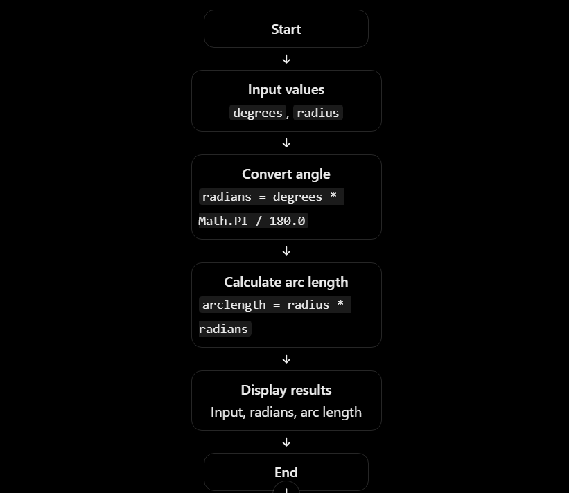
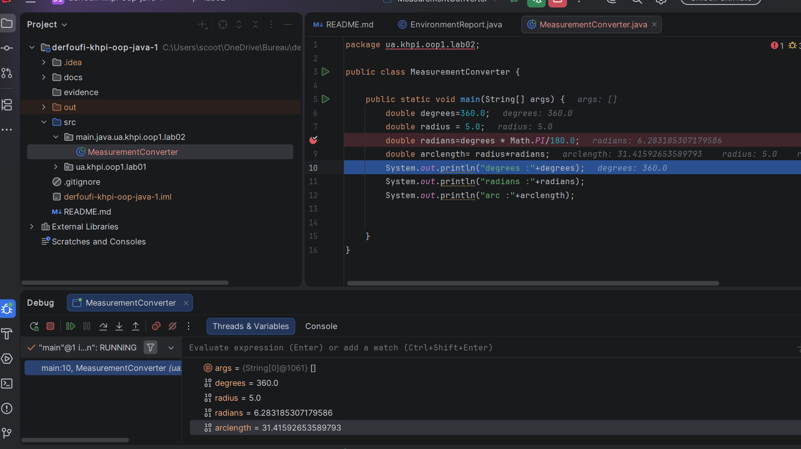

# Laboratory Work 2 Report

- **Topic:** Data Types, Literals, and Conversions
- **Author:** Ilyas Derfoufi
- **Group:** [КН-925к.е]
- **Variant:** 10
- **Repository:** https://github.com/iliyasderfoufi-pixel/derfoufi-khpi-oop-java-1
- **Branch:** `lab02`
- **Pull Request:** [To be added](https://github.com/iliyasderfoufi-pixel/derfoufi-khpi-oop-java-1/pull/2)
- 2. Purpose
The purpose of this laboratory work is to practise using Java primitive data types, numeric literals, and arithmetic operations. In Variant 10, the program converts an angular position from degrees to radians and calculates the arc length using the given radius.
2. Variant 10 — Angular Position

The program converts an angle from degrees to radians and calculates the arc length using the radius. It displays the input values, the intermediate result in radians, and the final arc length with their corresponding units.
4. Problem Analysis

4.1 Variables and Data Types
The program uses four variables of type double.

The variable degrees stores the input angle in degrees. The variable radius stores the radius in meters. The variable radians stores the angle after converting it from degrees to radians. Finally, the variable arclength stores the calculated arc length in meters.

The double data type is used because these values and calculation results may contain decimal fractions.

4.2 Formulas

First, the program converts the angle from degrees to radians using the following formula:

radians = degrees × π / 180

In Java, π is represented by Math.PI.

Next, the program calculates the arc length using the radius and the angle in radians:

arclength = radius × radians

The program then displays the input values, the intermediate result, and the final result with their corresponding units.
**Figure 1. Flowchart of the angular position conversion and arc-length calculation.**



## 5. Program Description

### 5.1 Class Structure

The program is implemented in a public Java class named `MeasurementConverter`. The `main()` method is the entry point of the program and contains the instructions executed when the program starts.

### 5.2 Calculation Process

The program defines the angle in degrees and the radius as `double` variables. It first converts the angle to radians using `Math.PI` and then calculates the arc length by multiplying the radius by the angle in radians. Finally, it prints the input values and calculated results.

### 5.3 Compilation and Execution

The program was compiled manually using the Java compiler (`javac`). The compiled class files were stored in the `out` directory. The program was then executed using the `java` command and its fully qualified class name.

The following commands were used:

```bash
javac -d out src\main\java\ua\khpi\oop1\lab02\MeasurementConverter.java
java -cp out ua.khpi.oop1.lab02.MeasurementConverter
```
6. Testing and Verification

6.1 Test Results
**Test 1 — Angle of 90 degrees**

The input angle was set to 90 degrees and the radius to 5.0 meters. The program calculated approximately 1.5708 radians and an arc length of 7.8540 meters.

**Test 2 — Angle of 0 degrees**

The input angle was set to 0 degrees and the radius to 5.0 meters. The converted angle and arc length were both 0.0.

**Test 3 — Angle of 180 degrees**

The input angle was set to 180 degrees and the radius to 5.0 meters. The program calculated approximately 3.1416 radians and an arc length of 15.7080 meters.

**Test 4 — Angle of 360 degrees**

The input angle was set to 360 degrees and the radius to 5.0 meters. The program calculated approximately 6.2832 radians and an arc length of 31.4159 meters.

### 6.2 Manual Numeric-Operation Checks

**Check 1 — Integer Division**

The expression `1 / 4` produces `0` because both operands are integers, so Java performs integer division. The expression `1.0 / 4` produces `0.25` because one operand is a floating-point value.

**Check 2 — Integer Overflow**

When `width` and `height` are both declared as `int` and multiplied, the result can overflow because the product exceeds the maximum value of `int`. Converting one operand to `long` before multiplication allows the calculation to produce the correct result, `4900000000`.

**Check 3 — Narrowing Conversion**

Converting the value `260.75` from `double` to `byte` first removes the fractional part and then converts the integer value to the range represented by the 8-bit `byte` type. The resulting value is `4`, demonstrating that narrowing conversions can change the original value.

**Check 4 — Floating-Point Approximation**

Floating-point values such as `0.1` and `0.2` cannot be represented exactly in binary. Therefore, their sum may differ slightly from `0.3`. The absolute difference can be calculated using `Math.abs(sum - 0.3)` and compared with a suitable tolerance.

## 7. Debugging

A breakpoint was set at the radians calculation in IntelliJ IDEA. The program was executed in Debug mode, and the variable values were inspected using the Variables pane. The debugging process confirmed that the angle was converted to radians before the arc length was calculated.



**Figure 2.** Variable values observed during debugging.

## 8. Conclusion

This laboratory work provided practice with Java primitive data types, numeric literals, and arithmetic operations. The program successfully converted an angle from degrees to radians and calculated the corresponding arc length using the given radius. Testing and debugging helped verify the calculations and understand the importance of choosing appropriate numeric types, avoiding integer overflow, and accounting for floating-point approximation.