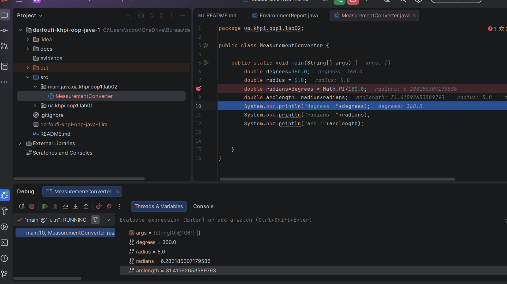

Laboratory Work 2 Report
- Topic: Data Types, Literals, and Conversions
- Author: Ilyas Derfoufi
- Group: [Add your group]
- Variant: 10 — Angular position
- Repository: https://github.com/iliyasderfoufi-pixel/derfoufi-khpi-oop-java-1
- Branch: lab02
- Pull Request: [Add the actual Lab 02 Pull Request URL]
1. Environment
- Language: Java
- JDK: Java 21
- IDE: IntelliJ IDEA
- Build and execution: manual javac and java commands, as required for Labs 1–9.
  Source file:

src/main/java/ua/khpi/oop1/lab02/MeasurementConverter.java

Package:

ua.khpi.oop1.lab02
2. Purpose
   The purpose of this laboratory work is to practise Java primitive numeric types, literals, arithmetic expressions, numeric promotion, narrowing conversions, integer overflow, and floating-point approximation.

The assigned Variant 10 task is to convert an angular position from degrees to radians and calculate the corresponding arc length.
3. Variant 10 — Task and mathematical model
   3.1 Inputs and output
   Quantity	Variable	Java type	Unit	Meaning
   Angular position	degrees	double	degrees (°)	Input angle
   Radius	radius	double	metres (m)	Radius of the circle
   Angular position in radians	radians	double	radians (rad)	Converted angle
   Arc length	arcLength	double	metres (m)	Length of the circular arc

The supplied assignment identifies the conversion and arc-length calculation. The PDF does not state numerical operating limits for the angle or radius. Therefore, the test values below are documented as selected test inputs, not as official permitted minimum and maximum limits.
3.2 Formulas
Degree-to-radian conversion:
\[
\theta_{\mathrm{rad}} = \theta_{\mathrm{deg}} \cdot \frac{\pi}{180}
\]
Arc length:
\[
s = r \cdot \theta_{\mathrm{rad}}
\]
where:
- \(\theta_{\mathrm{deg}}\) is the angle in degrees;
- \(\theta_{\mathrm{rad}}\) is the angle in radians;
- \(r\) is the radius in metres;
- \(s\) is the arc length in metres.
  3.3 Calculation sequence
1. Assign the angle and radius.
2. Convert the angle to radians using Math.PI.
3. Multiply the radius by the angle in radians.
4. Print the input, intermediate value, and result with units.
4. Program implementation
   The main calculation uses the following expressions:
   double radians = degrees * Math.PI / 180.0;
   double arcLength = radius * radians;
   Both expressions use double because the calculations involve fractional values and require floating-point precision.

The divisor 180.0 is a floating-point literal. Math.PI is a double constant. Consequently, the degree-to-radian calculation is performed using floating-point arithmetic.
5. Test datasets and execution results
   The program was executed with the following four datasets.
   Dataset	Angle	Radius	Expected arc length	Actual arc length	Result
   Typical	45°	5 m	3.926991 m	3.926991 m	Pass
   Minimum test value	0°	5 m	0 m	0 m	Pass
   Large test value	360°	100 m	628.318531 m	628.318531 m	Pass
   Error-prone small values	0.1°	0.001 m	0.000001745329 m	0.000001745329 m	Pass

The values in this table are selected test cases. The large test value is not claimed to be the maximum permitted input because the supplied variant statement does not define such a limit.
5.1 Typical dataset hand verification
For an angle of \(45^\circ\) and radius \(5\,m\):
\[
\theta_{\mathrm{rad}} = 45 \cdot \frac{\pi}{180}
= \frac{\pi}{4}
\approx 0.7853981634
\]
\[
s = 5 \cdot 0.7853981634
\approx 3.926990817\,m
\]
The program printed 3.926991 m, which agrees with the hand calculation to six decimal places.
5.2 Minimum test value
For \(0^\circ\):
\[
\theta_{\mathrm{rad}} = 0
\qquad
s = 5 \cdot 0 = 0\,m
\]
The program printed zero radians and zero arc length.
5.3 Large test value
For \(360^\circ\) and radius \(100\,m\):
\[
\theta_{\mathrm{rad}} = 360 \cdot \frac{\pi}{180}
= 2\pi
\approx 6.283185307
\]
\[
s = 100 \cdot 2\pi
\approx 628.318531\,m
\]
The program printed 628.318531 m.
5.4 Error-prone small values
For \(0.1^\circ\) and radius \(0.001\,m\):
\[
\theta_{\mathrm{rad}} = 0.1 \cdot \frac{\pi}{180}
\approx 0.001745329252
\]
\[
s = 0.001 \cdot 0.001745329252
\approx 0.000001745329\,m
\]
The program printed 0.000001745329 m to twelve decimal places.
6. Manual numeric-operation checks
   The four checks below are separate demonstrations of Java numeric behaviour. They are included in the program and were executed.
   6.1 Check 1 — Integer division
   double wrongRatio = 1 / 4;
   double correctRatio = 1.0 / 4;
   Expression	Actual result	Explanation
   1 / 4	0.0 after assignment to double	Both operands are integers, so integer division produces 0 first
   1.0 / 4	0.25	A floating-point operand makes the division floating-point

6.2 Check 2 — Intermediate product overflow
int width = 70000;
int height = 70000;

long wrongArea = width * height;
long correctArea = (long) width * height;
Expression	Actual result
width * height assigned to long	605032704
(long) width * height	4900000000

The first multiplication is evaluated as int, so it overflows before assignment to long. In the corrected expression, the cast is applied before multiplication, causing the multiplication to be evaluated as long.
6.3 Check 3 — Narrowing conversion
double source = 260.75;
byte narrowed = (byte) source;
Actual output:
Source: 260.75
Narrowed byte: 4
The conversion first discards the fractional part, leaving 260. A Java byte is an 8-bit signed integer. Converting 260 to byte retains the low eight bits, which represent 4.
6.4 Check 4 — Decimal approximation error
double sum = 0.1 + 0.2;
double difference = Math.abs(sum - 0.3);
Actual output:
Sum: 0.30000000000000004
Difference: 5.551115123125783E-17
Hexadecimal sum: 0x1.3333333333334p-2
Hexadecimal difference: 0x1.0p-54
The double type uses binary floating-point representation. The decimal fractions 0.1 and 0.2 cannot both be represented exactly as finite binary fractions. Therefore, their sum is not exactly equal to the stored representation of 0.3.

Floating-point values should be compared using a justified tolerance rather than relying on exact equality.
7. Compilation and execution
   From the repository root, the required Windows PowerShell commands are:
   New-Item -ItemType Directory -Force out | Out-Null
   javac -d out src\main\java\ua\khpi\oop1\lab02\MeasurementConverter.java
   java -cp out ua.khpi.oop1.lab02.MeasurementConverter
   The submitted execution output ended with:
   Process finished with exit code 0
   This confirms that the IntelliJ execution completed without a runtime error. A separate manual command-line execution should also be recorded before submission if it has not yet been performed.
8. Debugging evidence
   The laboratory instructions request a debugger screenshot showing the source code, the current execution line, and the Variables pane with intermediate values.

Evidence still to insert: add the actual IntelliJ IDEA debugging screenshot under docs/lab02/assets/ and link it here. No screenshot is claimed in this report until the real image is added.

Example Markdown after adding the screenshot:

9. Repository and submission evidence
- Source file: src/main/java/ua/khpi/oop1/lab02/MeasurementConverter.java
- Report file: docs/lab02/REPORT.md
- Branch: lab02
- Repository: https://github.com/iliyasderfoufi-pixel/derfoufi-khpi-oop-java-1
- Pull Request: [Insert the actual Lab 02 Pull Request URL]
  The course instructions require the report to be linked from the root README.md, and corrections to be pushed to the same branch and Pull Request.
10. Outstanding instructor clarification
    The review feedback mentions a required fixed-step calibration task. The supplied Lab 02 PDF contains Variant 10 (angular position), Variant 14 (sensor calibration), and Advanced Problem B (direct and inverse calibration), but it does not define a task named “fixed-step calibration”.

No implementation or expected results for fixed-step calibration are claimed here. The exact task specification must be obtained from the instructor before it can be implemented correctly.
11. Conclusion
    The Variant 10 program converts degrees to radians and calculates arc length. Four selected datasets were executed, and their actual outputs agreed with the corresponding calculations. The program also executes four separate numeric-operation checks demonstrating integer division, intermediate integer overflow, narrowing conversion, and floating-point approximation.