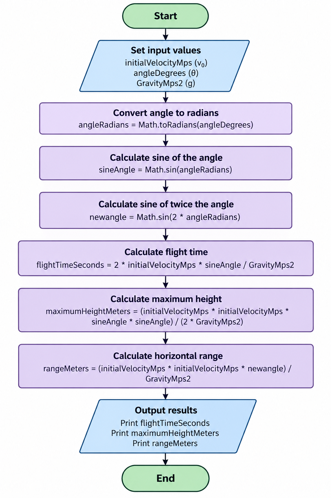
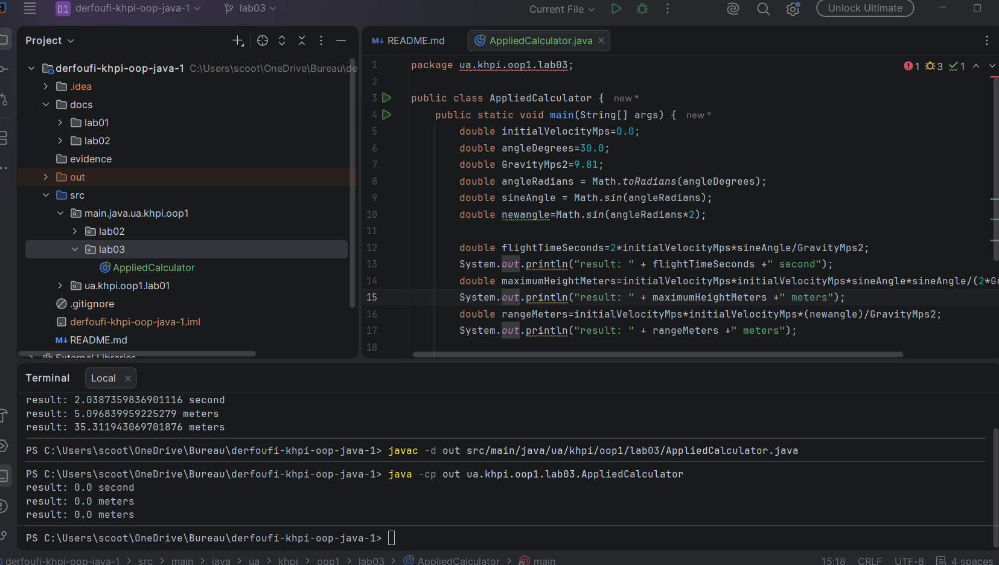
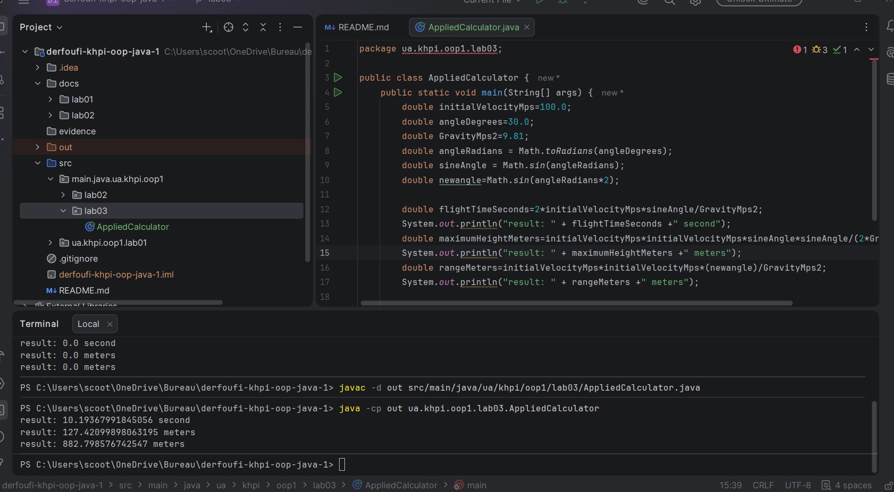
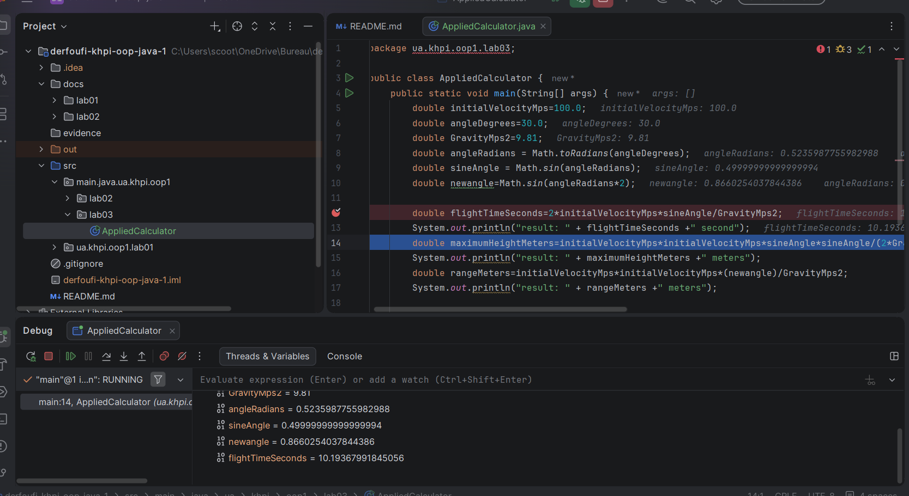

# Laboratory Work 3 Report

- **Topic:** Applied Calculations, Expressions, and Operators
- **Author:** Ilyas Derfoufi
- **Group:** [Add your group]
- **Assignment:** Variant 10 — Trajectory
- **Repository:** [https://github.com/iliyasderfoufi-pixel/derfoufi-khpi-oop-java-1](https://github.com/iliyasderfoufi-pixel/derfoufi-khpi-oop-java-1)
- **Branch:** `lab03`
- **Pull request:** [Add your Pull Request URL]

## 1. Purpose

The purpose of this laboratory work is to implement an applied calculation in Java, decompose formulas into intermediate expressions, use mathematical functions, and verify the results with test datasets.

## 2. Assignment

The assigned task is to calculate the flight time, maximum height, and horizontal range of a projectile without air resistance.

The calculations assume that the projectile lands at the same height from which it was launched. The gravitational acceleration is taken as 9.81 m/s².

## 3. Problem Analysis

### 3.1 Formulas and Units

The input quantities are:

- Initial velocity, (v_0), measured in metres per second (m/s).
- Launch angle, (\theta), measured in degrees.
- Gravitational acceleration, (g), measured in metres per second squared (m/s²).

The formulas used are:

- Flight time: (T = 2v_0\sin(\theta)/g)
- Maximum height: (H = v_0^2\sin^2(\theta)/(2g))
- Horizontal range: (R = v_0^2\sin(2\theta)/g)

Java's trigonometric methods use radians, so the launch angle is converted from degrees to radians before evaluating the sine.

### 3.2 Intermediate Values

| Variable              | Type     | Unit          | Purpose                        |
| --------------------- | -------- | ------------- | ------------------------------ |
| `initialVelocityMps`  | `double` | m/s           | Initial velocity               |
| `angleDegrees`        | `double` | degrees       | Launch angle                   |
| `GravityMps2`         | `double` | m/s²          | Gravitational acceleration     |
| `angleRadians`        | `double` | radians       | Converted angle                |
| `sineAngle`           | `double` | dimensionless | Sine of the launch angle       |
| `newangle`            | `double` | dimensionless | Sine of twice the launch angle |
| `flightTimeSeconds`   | `double` | seconds       | Total flight time              |
| `maximumHeightMeters` | `double` | metres        | Maximum height                 |
| `rangeMeters`         | `double` | metres        | Horizontal range               |

### 3.3 Expression Tree

The main formulas are evaluated using the following structure:

- Flight time: multiplication of 2, initial velocity, and the sine of the angle, followed by division by gravity.
- Maximum height: the square of the initial velocity multiplied by the square of the sine of the angle, divided by twice the gravitational acceleration.
- Horizontal range: the square of the initial velocity multiplied by the sine of twice the launch angle, divided by gravity.

### 3.4 Flowchart

The program follows this sequence:

1. Start.
2. Set the input values.
3. Convert the angle from degrees to radians.
4. Calculate the sine of the angle.
5. Calculate flight time.
6. Calculate maximum height.
7. Calculate horizontal range.
8. Print the results.
9. End.

**Screenshot:** Add the flowchart as `assets/flowchart.png`.

## 4. Class Structure

The program is implemented in the `AppliedCalculator` class in the package `ua.khpi.oop1.lab03`. The calculations are performed inside the `main` method.

## 5. Operator Precedence and Evaluation

The formulas use multiplication and division. These operators have the same precedence and are evaluated from left to right. Parentheses are used to group the denominator in the maximum-height formula.

The `Math.toRadians()` method converts the angle into radians, and `Math.sin()` calculates its sine. The intermediate variables make the calculations easier to inspect and debug.

## 6. Compilation and Execution

The program was compiled and executed manually using the JDK command-line tools.

```powershell
javac -d out src/main/java/ua/khpi/oop1/lab03/AppliedCalculator.java
java -cp out ua.khpi.oop1.lab03.AppliedCalculator
```

**Screenshot:** Add the successful compilation and execution output as `assets/terminal-run.png`.

## 7. Testing

### 7.1 Test Record

| Test         | Initial velocity | Angle | Expected property                      |
| ------------ | ---------------: | ----: | -------------------------------------- |
| Typical      |         20.0 m/s |   30° | Results agree with the formulas        |
| Minimum      |          0.0 m/s |   30° | All three results are zero             |
| Maximum test |        100.0 m/s |   30° | Results increase with velocity         |
| Special      |         20.0 m/s |   90° | Horizontal range is approximately zero |

The actual results for each dataset should be recorded from the corresponding program run. Attach screenshots of the terminal output for the four datasets.

### 7.2 Recorded Results

For the test with initial velocity 100.0 m/s and launch angle 30°, the program produced:

- Flight time: 10.19367991845056 seconds.
- Maximum height: 127.42099898063195 metres.
- Horizontal range: 882.798576742547 metres.

For the zero-velocity test, all three results were zero.

**Pending evidence:** Record the actual output for the typical test and the 90° special test after running them.

## 8. Debugging

A breakpoint should be placed before the first main calculation. Step Over can be used to inspect the intermediate variables and compare them with the expected values.

**Screenshot:** Add the IntelliJ debugger view as `assets/debugger.png`, showing the breakpoint and the Variables panel.

## 9. Independent Checking Property

For a launch angle of 90°, the horizontal range should be approximately zero because the projectile moves vertically under the assumptions of the model. This provides a special-case check for the range formula.

The check should be verified by running the program with an angle of 90° and recording the result.

## 10. Conclusions

This laboratory work applies Java arithmetic expressions and mathematical functions to a projectile-motion model. It demonstrates angle conversion, intermediate values, operator precedence, command-line compilation, and verification through test datasets.

## 11. Evidence Checklist

- [ ] `assets/flowchart.png` 
- [ ] `assets/zero.png`
- [ ] `assets/maximum.png`
- [ ] `assets/calc3.png`
- [ ] Pull Request URL added above
- [ ] README.md updated with a relative link to this report
